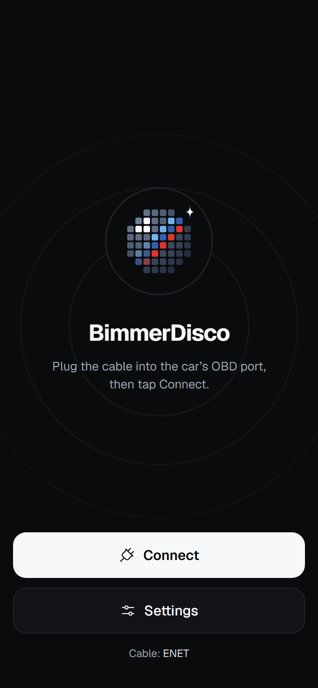
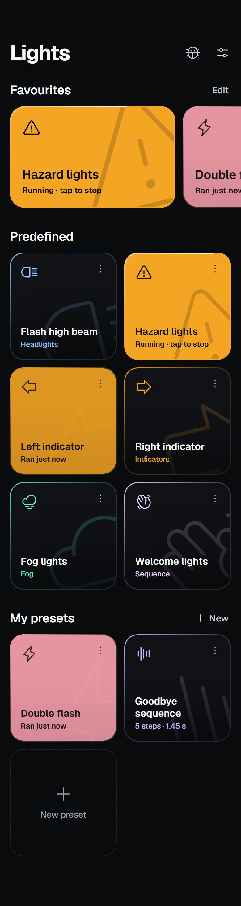
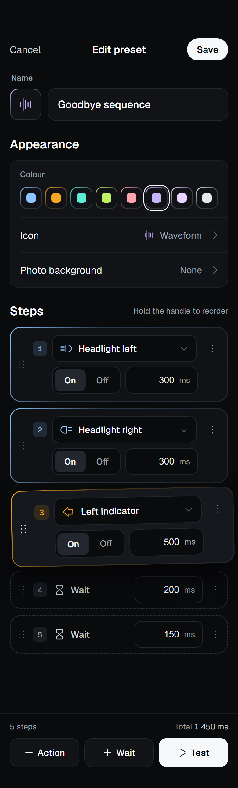
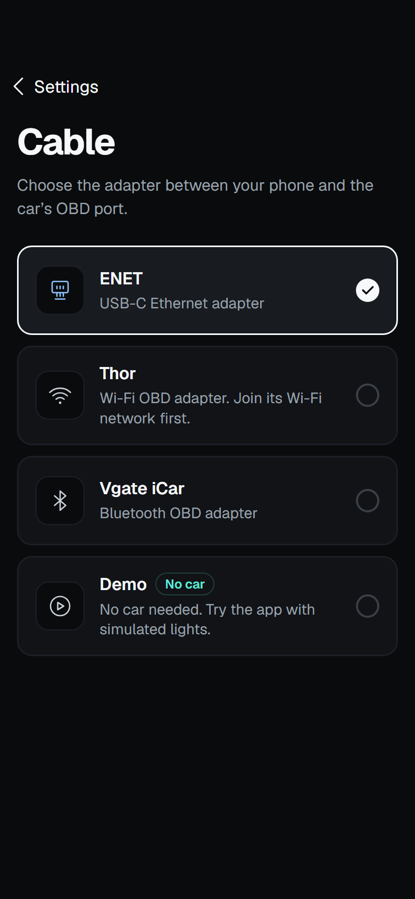
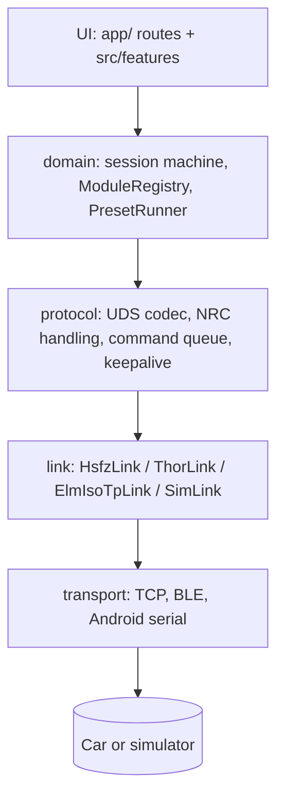

# BimmerDisco

Expo app for iOS and Android that runs light shows and presets on BMW F-series cars by sending UDS diagnostic commands through an OBD adapter. It includes a built-in Demo vehicle, so you can try the app without a car or adapter.

Hardware support and individual lighting mappings are still being validated. See [docs/PLAN.md](docs/PLAN.md) for current status and known limitations.

<p>
  
  
  
  
</p>

## Features

- Predefined actions (flash, headlight and taillight shows, party mode, toggles) filtered to the detected car's modules
- Custom presets built from steps, plus favourites
- Adapters: ENET (Ethernet), Thor (Wi-Fi), Vgate iCar (BLE) and Demo; Android also supports ELM327 Bluetooth Classic, ELM327 Wi-Fi and USB K+DCAN
- Forced light control is always restored on stop, completion, error, disconnect and app backgrounding
- English and Polish

## Requirements

- Node.js 24 and pnpm 10 (the versions used in CI)
- For device builds: Xcode on macOS (iOS) or the Android SDK (Android)
- A development build. Expo Go is not supported because the adapters use native modules.
- For a real car: a BMW F-series car and a supported adapter. Demo mode needs neither.

## Installation

1. Clone the repository and install dependencies:

   ```bash
   git clone git@github.com:michalkulesza/bmwdisco.git
   cd bmwdisco
   pnpm install
   ```

2. Build and run the app on a simulator or device:

   ```bash
   pnpm ios       # or: pnpm android
   ```

3. In the app, pick the **Demo** adapter to connect to the simulated car.

After the first native build, start only the Metro bundler with `pnpm start`.

## Configuration

Sentry is optional and is the app's only network use. Copy `.env.example` to `.env` and fill in your own values:

| Variable                 | Required | Default | Description                                                           |
| ------------------------ | -------- | ------- | --------------------------------------------------------------------- |
| `EXPO_PUBLIC_SENTRY_DSN` | No       | empty   | Sentry DSN for crash and problem reports. Leave empty to disable.     |
| `SENTRY_ORG`             | No       | empty   | Sentry organisation for source-map and dSYM upload in release builds. |
| `SENTRY_PROJECT`         | No       | empty   | Sentry project for the upload.                                        |
| `SENTRY_AUTH_TOKEN`      | No       | empty   | Auth token for the upload. Never commit it.                           |

## Development

```bash
pnpm typecheck                     # TypeScript
pnpm lint                          # ESLint
pnpm format:check                  # Prettier
pnpm test                          # Jest unit and screen tests
pnpm test:coverage --runInBand     # Tests with coverage (as in CI)
pnpm e2e:ios                       # Maestro E2E flows in Demo mode
```

ECU data is code-generated. Edit the source files in `data/ecu/`, then regenerate:

```bash
pnpm gen:data          # write src/data/generated/
pnpm gen:data:check    # fail if the generated output is stale (run in CI)
```

Do not edit `src/data/generated/` by hand. Release builds use `pnpm ios:release`, `pnpm android:release` or `pnpm android:apk`.

A pre-commit hook runs lint-staged (ESLint, Prettier, tsc). Use pnpm only; do not add an npm lockfile.

## Project structure

```
app/                expo-router routes (thin)
src/
  transport/        TCP, BLE and Android serial transports
  link/             adapter framing (HSFZ, Thor, ELM327 ISO-TP, simulator)
  protocol/         UDS codec, keepalive, command queue
  domain/           session machine (XState), presets, effects
  simulator/        simulated vehicle used by Demo mode and tests
  data/generated/   codegen output, do not edit
  stores/ ui/ features/ i18n/
data/ecu/           ECU source data
modules/            local native Expo modules
scripts/            data codegen and sync
e2e/                Maestro flows
```

## How it works

### Layers

Each layer talks only to the one below it, so the same UDS logic runs over every adapter and the Demo simulator.



- **transport** moves raw bytes over TCP (ENET, Thor, ELM327 Wi-Fi), BLE (Vgate iCar) or Android serial (Bluetooth Classic, USB).
- **link** adds adapter framing and exposes one call, `request(ecu, payload)`. HSFZ wraps UDS for ENET, Thor uses BMW-FAST frames with a checksum, and ELM327 splits messages into ISO-TP frames using AT commands.
- **protocol** encodes and decodes UDS, decodes negative response codes, waits on `0x78` (response pending) and sends tester-present keepalives. All requests go through one serialised command queue, with a priority lane for keepalive and stop.
- **domain** holds the session state machine (XState v5), the registry of detected modules and the preset runner.

### Sending and reading commands

Every command is a UDS request: one service byte followed by its parameters. The app uses these services:

| Service | Name                     | Used for                                                     |
| ------- | ------------------------ | ------------------------------------------------------------ |
| `10`    | DiagnosticSessionControl | `10 03` extended session before a run, `10 01` default after |
| `22`    | ReadDataByIdentifier     | `22 F1 50` to identify each module                           |
| `2E`    | WriteDataByIdentifier    | aggregate light writes, e.g. FEM `2E D5 42 …`                |
| `2F`    | InputOutputControl       | forcing a single light, e.g. FEM `2F 45 01 03 <ch> <state>`  |
| `31`    | RoutineControl           | LED routines on headlight modules                            |
| `3E`    | TesterPresent            | `3E FF` keepalive while a session is open                    |
| `28`    | CommunicationControl     | `28 02 01` for headlight LED effects, undone with `28 00 03` |

The request bytes come from the generated ECU data (`src/data/generated/`), not from hand-written code. Each module has a one-byte diagnostic address, such as `40` for FEM_20.

**Sending.** The link wraps the request for the adapter. For example, `22 F1 50` sent to FEM_20 (`40`) goes out as:

| Adapter | Bytes on the wire                  | Format                                                                |
| ------- | ---------------------------------- | --------------------------------------------------------------------- |
| ENET    | `00 00 00 05 00 01 F4 40 22 F1 50` | HSFZ over TCP 6801: 4-byte length, type `0001`, tester `F4`, ECU      |
| Thor    | `83 40 F1 22 F1 50 17`             | BMW-FAST over TCP 23: `80`+length, ECU, tester `F1`, data, checksum   |
| ELM327  | `40 03 22 F1 50` on CAN ID `6F1`   | ISO-TP with extended addressing, written as hex text over AT commands |
| Demo    | `22 F1 50`                         | passed straight to the simulated vehicle                              |

On ELM327, requests longer than one CAN frame are split into a first frame and consecutive frames, paced by the ECU's flow-control reply. The ECU answers on CAN ID `600` + its address (`640` for FEM_20).

**Reading.** A parser for each adapter collects incoming bytes until a full frame has arrived, removes the framing and drops echoes and frames from other ECUs. The protocol layer then matches the reply against the pending request:

- **Positive:** the first byte is the service plus `40` (`22` → `62`), and the identifier echoes the request. `62 F1 50 …` answers `22 F1 50`.
- **Pending:** `7F <service> 78` means the ECU is still working, so the app keeps waiting for the real reply.
- **Negative:** `7F <service> <code>` is a refusal. The code is decoded into a readable reason, for example `22` (conditions not correct) asks you to stop the car or turn the ignition on.
- **Unrelated:** anything else is ignored.

There are no transaction IDs, so only one request is in flight at a time. All requests wait in a single command queue, and keepalive and stop go ahead of the rest. A timeout fails the link, because a late reply could not be told apart from the next one. The session then reconnects and restores the lights.

### Connection flow

The session machine moves through these states:

```
idle → connecting → identifying → ready ⇄ running → restoring → disconnected | error
                                                                 (+ reconnecting)
```

1. **Connecting:** the selected adapter's transport and link open.
2. **Identifying:** the app reads `22 F1 50` from each known F-series module. Only modules that answer are registered, and actions are filtered to the lights they control. If no known module answers, presets stay locked.
3. **Running:** a preset is a list of steps. The runner enters the extended diagnostic session (`10 03`), forces each light with IO control or routine commands from the generated ECU data, and keeps the session alive while it runs.
4. **Restoring:** the runner switches every light it touched off, returns control to the ECU, re-enables communication if it was silenced (`28 00 03`) and returns to the default session (`10 01`).

### Safety

Restoring always runs: on stop, on completion, on error, on disconnect and when the app goes to the background (iOS suspends sockets and BLE). After a lost link the app reconnects up to three times and restores first. One-shot runs are capped at 90 seconds, and the command rate is throttled to the adapter's measured round-trip time. The full policy is in [docs/PLAN.md](docs/PLAN.md#safety-policy).

### ECU data

Module addresses, light channels and command bytes live as source data in `data/ecu/`. `pnpm gen:data` validates them with zod and writes typed modules to `src/data/generated/`, which are loaded only for the modules the car has. Demo mode uses the same data to drive a simulated vehicle, which also backs the tests.

## Documentation

- [docs/PLAN.md](docs/PLAN.md): decisions, architecture, safety policy and milestone progress
- [docs/android-connection-notes.md](docs/android-connection-notes.md): Android adapter setup
- [docs/lhm2-headlights.md](docs/lhm2-headlights.md): LHM2 headlight module notes
- [docs/logical-actions-inventory.md](docs/logical-actions-inventory.md): logical light actions

## Contributing

Read [AGENTS.md](AGENTS.md) and [docs/PLAN.md](docs/PLAN.md) first. Keep the restoration safety policy intact, and add every user-facing string to both `src/i18n/en.json` and `src/i18n/pl.json`.

## License

<!-- TODO: no LICENSE file exists yet; add one and name it here. -->
