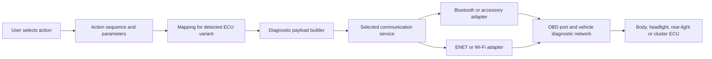

# How BimmerLight connects to the car and sends commands

Analyzed the supplied extracted **BimmerLight 3.8, build 54** (`com.bimmerlight.prod`) on 2026-10-12. Everything below is based on local package resources and static binary inspection. The app was not run, and no adapter or car was contacted.

The recovered car-control path uses **local OBD diagnostic communication**. The phone connects to a diagnostic adapter, which bridges commands to the vehicle's control units. Light shows are sequences of diagnostic output-control operations. Separate Internet clients download command resources and provide other application services; their existence does not turn these local diagnostic commands into BMW cloud API calls.

## Start with these files

- [COMMAND-REFERENCE.md](COMMAND-REFERENCE.md): meanings of the distinct symbolic command IDs, including explicitly unresolved channel names.
- [command-catalog.csv](command-catalog.csv): all **1,554** ECU-specific mappings, with function names, arguments and resource locations.
- [command-catalog.json](command-catalog.json): the same mappings plus relevant schemas, templates, destinations, pack summaries and integrity evidence.
- [job-catalog.csv](job-catalog.csv): all **3,241** bundled raw diagnostic job templates. These are a broader diagnostic dictionary; presence does not establish that a normal light action calls a job.
- [command-findings.md](command-findings.md), [connection-inventory.md](connection-inventory.md), [protocol-findings.md](protocol-findings.md): detailed evidence and qualifications.

## Connection to the vehicle



The app's setup instructions say to plug the adapter into OBD, turn on ignition, select the adapter, and tap Connect. The engine need not be running. The G-series help mentions pressing Start three times for diagnostic mode. These are embedded app instructions, not actions performed in this investigation. [Connection evidence](connection-inventory.md)

There are three principal phone-side paths:

| Path | Recovered implementation | What it does |
|---|---|---|
| Bluetooth Low Energy | CoreBluetooth; `BluetoothServiceBase`, vendor-specific subclasses, `IsoTpBluetoothServiceBase` | Discover a peripheral, discover/select GATT characteristics, write diagnostic data and receive notifications. The adapter handles the vehicle-side connection. |
| External Accessory | `OBDLinkEAService`; plist protocol `com.obdlink` | Use an iOS accessory session and input/output streams for the OBDLink accessory route. |
| Local network | `HSFZNetworkService`, `ThorNetworkService`, `VlinkerNetworkService`, `NetworkServiceBase` | Discover or connect to an IP/port, send framed requests and process replies. HSFZ is the ENET-style route. |

The interface enum includes UniCarScan, OBDLink, OBDLink MX, Konnwei, vLinker, Vgate iCar, Veepeak, BimmerCommander, HSFZ, THOR, Wi-Fi, BM3, MHD and modBM. This establishes implementation options in this package, not compatibility of every adapter with every car. Embedded help describes E-series primarily using Bluetooth and F/G-series supporting ENET/Wi-Fi as well.

There is also a phone-to-adapter command layer: embedded AT-style strings include `ATZ`, `ATSPB`, `ATCAF0`, `ATFCSH6F1` and `ATSH6F1`. These are adapter configuration/transport commands, separate from names such as `LOW_BEAM_LEFT` and the diagnostic payload sent to an ECU. Exact per-adapter initialization order was not fully reconstructed. [Literal and instruction anchors](adapter-constants.txt)

The network detection path contains broadcast support and `169.254.255.255`; the vLinker path logs `192.168.0.10`. Do not use either address as a universal endpoint. Adapter-specific settings and discovered vehicle addresses matter. Recovered adapter constants and their confidence are in [adapter-constants.txt](adapter-constants.txt).

A focused instruction/field-layout pass also recovered these network ports. The values are local static observations; no listener or successful connection was tested:

| Route | Port | Evidence and confidence |
|---|---|---|
| HSFZ discovery | `6811` | Broadcast sender constructs an IPv4 destination containing network-order `1A 9B`; direct byte-construction evidence. |
| HSFZ vehicle connection | `6801` | Constructor field named `vehiclePort` and detection closure load; less complete call tracing than the discovery sender. |
| THOR direct connection | `23` | Constructor stores `directPort=23`; detection passes it into `connectTo(ip:port:)`. |
| vLinker network | `35000` | Port-construction path and connection log pair this value with `192.168.0.10`. |

The exact socket type was not fully resolved for every path; these port numbers alone do not establish TCP/UDP or guarantee that a connected device exposes that endpoint. [Port evidence appendix](protocol-findings.md)

Vehicle identification is important: bundle jobs include `IDENT` (`22 F1 50` on modern variants), VIN and vehicle-order reads. `ecu_modules.json` associates address/identification values with ECU variants. A model name alone does not select a reliable command table; fitted ECU variants and hardware options affect the result.

Examples of diagnostic destinations from the bundles: FEM/BDC `40`, left/right headlight modules `43`/`44`, instrument cluster `60`, and FRM/REM `72`. These are hexadecimal diagnostic address bytes, not TCP ports or CAN arbitration identifiers. Some alternate module families share an address. [Complete address table](command-findings.md)

## How a light command becomes bytes

1. An action pack (`flash`, `headlight_show`, `party_mode`, etc.) supplies a sequence of symbolic steps and parameter strings, with a separate `disable` sequence.
2. The app resolves a symbolic command against the active vehicle's ECU mappings. For example, `LOW_BEAM_LEFT` is an app-level identifier; `STEUERN_LEUCHTENAUSGANG_DIGITAL` is one ECU job/function that implements it.
3. Parameters such as `{param_aktion}` are substituted. Packs generally use `1` for on and `0` for off; other families use start/stop routine symbols, PWM, time or current fields.
4. The engine builds a diagnostic payload from a job template, named function schema, light bit-mask template or special raw/session handler.
5. Diagnostic transport adds addressing. The selected communication implementation translates the internal representation to its adapter's representation and sends it. Replies are parsed and errors propagated.

Static method evidence includes `ExecuteLightServiceImpl.enqueue`, `EdiabasServiceImpl.executeJob`, engine actuation/read paths and communication-service `sendRequest`. The binary has an engine feature setting `ek.useUdsEngine` whose observed default branch is enabled. Some bundled developer documentation describes older read routing; the inspected binary contains engine read construction and decoding. See [protocol-findings.md](protocol-findings.md) for addresses and limits rather than assuming every sentence in the documentation is current.

### Concrete example: left low beam on FEM_20

The mapping at [FEM_20.json](decrypted/FEM_20.json) selects channel `01`. Its UDS bundle supplies destination `40` and job template `2F 45 01 03 00 00`. With on-state `1`, the derived payload is:

```text
2F 45 01 03 01 01
│  └─┬─┘ │  │  └── action: on
│    │   │  └───── output channel: left low beam
│    │   └──────── short-term adjustment
│    └──────────── identifier: 4501
└───────────────── input/output control service
```

Off is `2F 45 01 03 01 00`. These are recovered payloads; ECU acceptance and physical operation were not observed.

The same command produces different payloads elsewhere:

| ECU variant | Left-low-beam on payload |
|---|---|
| FEM_20 | `2F 45 01 03 01 01` |
| BDC_G05 | `2F E3 B5 03 01 01` |
| BCP_SP21 | `2F E3 B5 03 00 01` |
| FRM3 | `2F 01 04 03 64` |
| LCM | `D0 10 0C 00 00 00 00 40 00 00 00 00 00 00 00` |

These derivations come from the corresponding mappings/schemas, not one universal BMW command. The LCM example is a legacy DS2 light template with different state handling. [Exact sources and other examples](command-findings.md)

## The packet on ENET differs from the internal frame

For the FEM_20 example, the short internal diagnostic envelope is:

```text
86 40 F1 | 2F 45 01 03 01 01
```

`86` encodes a six-byte payload; `40` is the ECU destination; `F1` is the internal tester/source byte. A transport using the additive-checksum form appends `31` (the preceding-byte sum modulo 256).

The recovered HSFZ builder at EdiabasKit virtual address `0x3d398` constructs a different network frame:

```text
00 00 00 08 | 00 01 | F4 40 | 2F 45 01 03 01 01
length=8      type=1  src dst   diagnostic payload
```

Length includes the two address bytes and six payload bytes. This path converts internal source `F1` to network tester source `F4`, and copies the diagnostic payload after the eight-byte header. The internal format byte and additive checksum are not that ENET header. The THOR path has a separate checksum helper. BLE/ELM-style adapters additionally have configuration, addressing and segmentation behavior. Do not send a logical payload as though it were already a complete packet for every transport.

This frame is a static reconstruction of the inspected builder, not a captured packet. [Focused instruction evidence](transport-instructions.txt), [partial-decoder reproducer](transport_instructions.py)

## Which commands do what

| Command family | Meaning |
|---|---|
| `LOW_BEAM_*`, `HIGH_BEAM_*`, `DAYTIME_*` | Low beam, high beam, daytime running light outputs/functions. |
| `POSITION_*`, `PARK_*`, `REAR_*` | Position/parking or rear-light functions; use each mapping's description for its actual output. |
| `INDICATOR_FRONT_*`, `INDICATOR_REAR_*`, `INDICATOR_SIDE_*` | Turn-indicator outputs at those locations. |
| `BRAKE_*`, `FOG_FRONT_*`, `FOG_REAR_*`, `REVERSE_*`, `LICENSE_*` | Brake, fog, reverse and license-plate outputs. |
| `WELCOME_LIGHT`, `GOODBYE_LIGHT`, `FOLLOW_ME_HOME`, `HAZARD` | Aggregate ECU lighting functions rather than necessarily one physical lamp. |
| `LED_n_*`, `GROUP_n_*`, `REAR_LED_n_*` | ECU-specific numbered channels/groups. Their physical assignment is not universal. |
| `KOMBI_ON`, `KOMBI_OFF` | Instrument-cluster feedback/telltale routine; exact bytes vary by cluster. |
| `DIAGNOSE_MODE_ON`, `DIAGNOSE_MODE_OFF` | Diagnostic session changes; modern examples are `10 03` and `10 01`. |
| `COMMUNICATION_ON`, `COMMUNICATION_OFF`, `CC_*` | Diagnostic CommunicationControl operations; these do not mean phone/adapter connection or disconnection. |
| `RETURN_CONTROL`, `RESET_TO_ECU`, `STOP_ROUTINE` | Separate ECU-control restoration/reset-to-default/routine-stop operations. The names are not interchangeable. |

For FEM_20, the mapped communication payloads are `28 00 03` and `28 02 01`. `RETURN_CONTROL` is `2F 45 01 00 FE`; it differs from setting a light's state byte to zero. `DIAGNOSE_MODE_OFF` returning to default session also differs from a real ECU-reset job such as `11 01`.

Keepalive is ECU/protocol-dependent: the resources contain modern `3E FF`, older `3E 01` and legacy fixed frames. A single universal keepalive would misdescribe this package.

The readable [complete command reference](COMMAND-REFERENCE.md) and [mapping CSV](command-catalog.csv) cover the actual names. Unknown/placeholder IDs are labeled, and each exact mapping retains its original arguments.

## Evidence ledger and coverage

These are **local finding IDs**, not invented REA Evidence IDs:

| ID | Finding / evidence | Status and boundary |
|---|---|---|
| LOCAL-01 | App plist: version 3.8/build54; three executable SHA-256 identities below | Direct local byte/metadata observation. |
| LOCAL-02 | 116 encrypted resources authenticated with AES-GCM; decoded JSON equals existing extracted JSON; resource hashes match package CodeResources | Direct verification, retained per-file in command-catalog.json. Does not verify Apple signing trust/publisher identity. |
| LOCAL-03 | 51 mapping files; 1,554 mappings; 255 nonempty distinct command IDs plus one empty ID; 9 packs/285 actions | Direct parsed-resource counts. Not a count of working or user-visible features. |
| LOCAL-04 | BLE, accessory and network implementations; declared permissions and embedded setup help | Static declarations, symbols and strings; detailed in connection-inventory.md and adapter-constants.txt. No runtime connection observed. |
| LOCAL-05 | Representative payloads, parameters, release/reset operations | Resource derivations and focused native instruction inspection. Detailed in command-findings.md/protocol-findings.md. |
| LOCAL-06 | HSFZ frame construction at0x3d398, THOR helper at0x40eec | Focused static instruction evidence. No packet capture or ECU acceptance test. |
| LOCAL-07 | Exact scheduling, complete hardware/channel assignments and per-vehicle success | Partially answered or unresolved. No current car/adapter identity or runtime trace was supplied. |

Executable identities:

```text
BimmerLight      ae934b4ebf3b1f2e87d1da6566314315bf6c4973ad050914323b308ebf6890ae
EdiabasKit       a16095fb744d0a93a557c1c2dbdc2f794fdda6a39e91a3e7e5fe6c2ecaf96362
BimmerLightKit   8dc6949bf0e39ea035bdf9f9293e3a1fceb1ff275803afd866fbd43c8b6a59e8
```

Material gaps include specialized LHM2 field-update logic, older RLM schema/argument-order discrepancies, DS2 per-channel off handling, and a KOMB_SP21 mapping without a corresponding UDS bundle. The full job dictionary also exposes operations beyond ordinary light actions. The catalog preserves these facts rather than claiming to be a fully verified command compiler.

REA successfully identified/opened the ARM64 executable and reported provider availability. Native decompilation was unavailable: no Ghidra/IDA provider was configured, and Hopper/Apple-native inspection is unsupported on this Windows host. The client rejected `inspect_artifact` and `close_binary` with `MCP tool call requires approval, but approval policy is never`. Local static parsing supplied the evidence instead. No deep-analysis engine or target runtime was launched; the close request could not clear REA's target binding. See [rea-session-summary.json](rea-session-summary.json). No REA Evidence IDs were returned by the successful lifecycle/status calls.

Original checklist: target identity **answered**; connection mechanisms **answered statically**; command selection/building **answered for the inspected common paths, with documented variant gaps**; command inventory/meanings **cataloged, with hardware-specific unknowns labeled**; live wire behavior and actual-car acceptance **not observed**.
